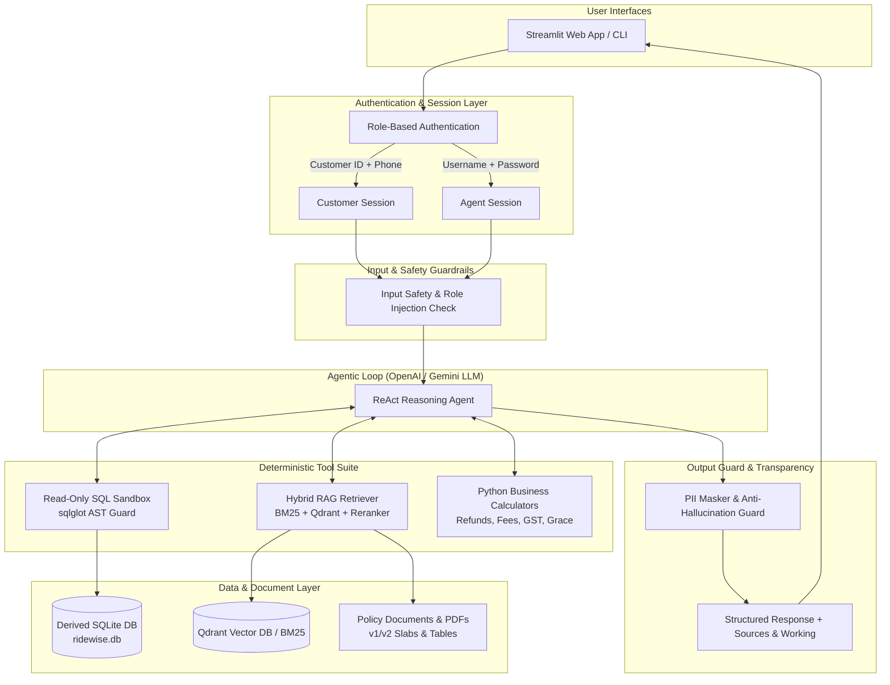

# 🛵 RideWise Assist

> **Enterprise Multi-Role AI Assistant & Operations Engine for Electric Vehicle & Bike Rentals**

RideWise Assist is an end-to-end, production-grade AI operations and customer support platform designed for **RideWise**, an electric vehicle and bike rental service. It combines structured database query capabilities, hybrid Retrieval-Augmented Generation (RAG) across legal/policy documents, and deterministic financial calculators within a secure, multi-role architecture.

---

## 📌 Table of Contents
- [System Architecture](#-system-architecture)
- [Key Features & Highlights](#-key-features--highlights)
- [Multi-Role Security & Authentication](#-multi-role-security--authentication)
- [Policy Engine & Business Logic](#-policy-engine--business-logic)
- [Data Layer & Read-Only SQL Sandbox](#-data-layer--read-only-sql-sandbox)
- [Hybrid RAG & Document Processing](#-hybrid-rag--document-processing)
- [Trust, Safety & PII Protection](#-trust-safety--pii-protection)
- [Project Directory Structure](#-project-directory-structure)
- [Installation & Setup](#-installation--setup)
- [Configuration (.env)](#-configuration-env)
- [Running the Application](#-running-the-application)
- [Demo Credentials](#-demo-credentials)
- [Evaluation & Testing](#-evaluation--testing)

---

## 📐 System Architecture



---

## ✨ Key Features & Highlights

- 🔐 **Role-Aware Dual Architecture**: Strict separation of concerns between Customer self-service and Enterprise Support Agent operations.
- 🧮 **Deterministic Financial Calculators**: Code-enforced business logic for cancellation refunds, late return penalties, battery depletion fees, and 18% GST tax calculations.
- 🔍 **Hybrid Lexical & Vector RAG Engine**: Combines BM25 keyword matching with dense FastEmbed / Qdrant vector search and optional Jina cross-encoder re-ranking.
- 🖼️ **OCR & PDF Table Extraction**: Multi-modal document ingestion using PyMuPDF and RapidOCR to parse image-based policy tables (v2 refund slabs, GOLD grace period tables, EV battery bands).
- 🛡️ **Read-Only SQL Sandbox**: AST-validated SQL query engine using `sqlglot` with `sqlite3` authorizer restrictions to prevent unauthorized writes or schema leaks.
- 🔒 **PII & Data Safety**: Automated regex and contextual masking of phone numbers, email addresses, and sensitive identification across database views and AI responses.
- 📊 **Auditable & Transparent**: Live execution breakdown in the Streamlit UI ("Sources & Working") exposing policy citations, calculation steps, raw SQL queries, and tool response latencies.
- 📈 **Ground-Truth Evaluation Benchmark**: Includes a 47-case evaluation suite covering multi-role financial, policy, safety, and escalation queries with automated scoring.

---

## 🔐 Multi-Role Security & Authentication

RideWise Assist implements strict Role-Based Access Control (RBAC):

### 1. Customer Role
- **Authentication**: Customer ID (e.g., `CUST0001`) + Registered 10-digit Phone Number.
- **Access Boundary**: Customer sessions are restricted to parameterized tools scoped exclusively to their own `customer_id`. Direct free-form SQL execution is blocked for customers.
- **Capabilities**: View booking history, inspect charges, calculate refund eligibility for upcoming cancellations, view ticket status, and request human agent escalation.

### 2. Support Agent Role
- **Authentication**: Agent Username + Password (PBKDF2-HMAC-SHA256 with 310,000 iterations).
- **Access Boundary**: Enterprise-wide read-only data view across all hubs, vehicles, customers, and bookings.
- **Capabilities**: Run natural-language-to-SQL analytics, query vehicle telemetry, inspect damage claims, search policy documents, and manage the live human escalation queue.

### 3. Security Hardening
- **Timing-Attack Protection**: Constant-time credential verification and dummy password hash evaluation for non-existent agent usernames.
- **Generic Error Messaging**: Authentication errors do not reveal whether a Customer ID or Agent username exists.
- **Account Lockout**: 5 consecutive failed attempts lock out the account for 15 minutes.
- **Audit Logging**: All sign-in attempts are appended to `logs/auth.jsonl` (with phone numbers masked).

---

## 🧮 Policy Engine & Business Logic

RideWise Assist enforces deterministic Python calculators for financial math to eliminate LLM arithmetic hallucinations:

| Policy Area | Rule & Calculation Logic | Reference |
|---|---|---|
| **Cancellation Policy Cutoff** | **v1 Policy**: Booked before `2026-06-30 18:30:00` UTC (`2026-07-01 00:00:00` IST).<br>**v2 Policy**: Booked on or after `2026-07-01 00:00:00` IST. | RW-POL-01 |
| **v1 Refund Slabs** | ≥24h prior: 100% refund \| 6–24h prior: 50% refund \| <6h prior: 0% refund. | Annexure 1 (v1) |
| **v2 Refund Slabs** | ≥48h prior: 100% refund \| 12–48h prior: 75% refund \| 2–12h prior: 25% refund \| <2h prior: 0% refund. | Annexure 1 (v2) |
| **Tier Grace Periods** | **GOLD**: 30-minute grace period (up to and including min 30). Returns >30 min late are charged full lateness from minute 1.<br>**SILVER / STANDARD**: 0 grace minutes. | Annexure A |
| **Late Return Fee** | $\text{Late Fee} = \lceil\text{Late Hours}\rceil \times 1.5 \times \text{Hourly Rate}$. Partial hours round up to full hours. | RW-POL-02 §3.1 |
| **EV Battery Charges** | Battery <10%: Flat ₹150 penalty.<br>Battery ≥10%: ₹0 penalty.<br>Added to any late return fees. | EV Battery Band Figure |
| **Rental Charge Formula** | $\text{Rental} = (\text{Full 24h Blocks} \times \text{Daily Rate}) + \min(\text{Remaining Hours} \times \text{Hourly Rate}, \text{Daily Rate})$. | RW-POL-01 §4.2 |
| **Taxes & Deposits** | **GST 18%** applies to rentals and penalty charges.<br>**Security Deposits** carry **0% GST**. Deposit returns are unrecorded in DB per policy (never mark as missing). | RW-POL-01 §5.3 |

---

## 🗄️ Data Layer & Read-Only SQL Sandbox

The system operates on an isolated derived SQLite database (`data/derived/ridewise.db`) created via `scripts/build_derived.py`, which attaches the primary dataset read-only.

### Clean & Masked Database Views
- **`v_customers`**: Standardizes city names (`BLR`, `Bangalore`, `Bengaluru` $\rightarrow$ `Bengaluru`), masks phone numbers and emails (`98xxxxxx39`, `s***@gmail.com`), drops direct PII (driving license & DOB).
- **`v_payments`**: Masks free-text remark fields containing phone/email contact details.
- **`v_booking_facts`**: Denormalized single-row view per booking containing pre-calculated `duration_hrs`, `late_minutes`, `policy_version` (v1/v2 based on IST cutoff), `rental_paid`, `penalty_paid`, `refund_total`, and `deposit_paid`.

### SQL Sandbox Safety
- **Read-Only Connection**: SQLite opened via `file:...?mode=ro` with `PRAGMA query_only=ON`.
- **AST Parser Guard (`sqlglot`)**: Validates every generated query against an Abstract Syntax Tree (AST), rejecting non-`SELECT` statements, system tables, or unauthorized subqueries.
- **Row & Memory Limits**: Enforces hard upper bounds on returned rows (`MAX_ROWS = 100`) and query execution timeouts.

---

## 🔎 Hybrid RAG & Document Processing

The RAG subsystem processes policy documentation located in `docs/policies/`:

1. **Ingestion & Parsing**:
   - Parses text and complex tables across PDFs using **PyMuPDF (`fitz`)**.
   - Applies **RapidOCR** on scanned image annexures to capture non-selectable policy tables (v2 slabs, grace bands).
2. **Chunking & Metadata Indexing**:
   - Chunks documents by logical clause structure with metadata tags: `document_id`, `policy_version`, `effective_date`, `clause_number`.
3. **Hybrid Search Architecture**:
   - **Sparse Search**: BM25 lexical keyword matching.
   - **Dense Search**: Vector embeddings via `FastEmbed` (`BAAI/bge-small-en-v1.5`) backed by `Qdrant`.
   - **Reciprocal Rank Fusion (RRF)**: Merges sparse and dense search scores.
   - **Re-ranking (Optional)**: Refines results using `jina-reranker-v1-tiny-en`.

---

## 🛡️ Trust, Safety & PII Protection

- **Input Guard**: Screens user inputs for prompt injection, role spoofing, or systemic jailbreak attempts.
- **Anti-Hallucination Ticket Guard**: Verifies claimed support ticket numbers against live database records. If the model promises a hand-off without creating a ticket, the guard automatically generates a legitimate ticket in `data/escalations.jsonl`.
- **Contextual Masking**: Sanitizes phone numbers, email IDs, and sensitive tokens in model responses before display to users.

---

## 📁 Project Directory Structure

```
g:\Neostats
├── app/
│   ├── agent/             # Agent ReAct loop, system prompts, schemas, tools
│   ├── auth.py            # RBAC, PBKDF2 authentication, lockout & audit logs
│   ├── config.py          # Environment settings & LLM configuration
│   ├── data/              # Database connection helper & derived schema creation
│   ├── rag/               # Indexing, hybrid retriever, BM25 & Qdrant vector store
│   ├── safety/            # Input/output safety guards & PII masking
│   └── tools/             # Deterministic calculators, SQL guard, database tools
├── config/
│   ├── policy_rules.yaml  # Structured rule thresholds & refund parameters
│   └── users.yaml         # Salted PBKDF2 hashes for support agent accounts
├── data/                  # Primary SQLite DB, derived DB, and vector indices
├── docs/
│   ├── IMPLEMENTATION_PLAN.md
│   └── policies/          # Raw policy PDFs (RW-POL-01 to RW-POL-05)
├── eval/
│   └── questions.yaml     # 47 evaluation test cases with ground-truth answers
├── logs/                  # Audit logs (auth.jsonl)
├── scripts/
│   ├── add_agent.py       # CLI script to add support agent accounts
│   ├── build_derived.py   # Data cleaning & view creation script
│   ├── build_index.py     # Document parsing & vector indexing pipeline
│   ├── chat_cli.py        # Terminal-based chat interface
│   ├── check_llm.py       # API connection verification utility
│   └── run_eval.py        # Automated evaluation suite benchmark runner
├── tests/                 # Comprehensive unit & integration test suite (pytest)
├── streamlit_app.py       # Interactive Streamlit Web Application
├── requirements.txt       # Core project dependencies
└── .env.example           # Environment variable template
```

---

## ⚙️ Installation & Setup

### 1. Prerequisites
- Python **3.10** to **3.13**
- Git

### 2. Clone Repository & Setup Virtual Environment
```bash
git clone https://github.com/vidhunks/ridewise-assist.git
cd ridewise-assist

# Create virtual environment
python -m venv .venv

# Activate virtual environment
# Windows (PowerShell):
.venv\Scripts\Activate.ps1
# Linux/macOS:
source .venv/bin/activate
```

### 3. Install Dependencies
```bash
# Core requirements
pip install -r requirements.txt

# Optional: OCR support for scanned policy images
pip install -r requirements-ocr.txt
```

---

## 🔑 Configuration (.env)

Create a `.env` file in the root directory by copying `.env.example`:

```bash
cp .env.example .env
```

Configure your environment variables in `.env`:

```ini
# OpenAI-Compatible API Endpoint (Azure OpenAI, OpenAI, or Custom LLM Gateway)
LLM_BASE_URL=https://your-llm-endpoint/v1/
LLM_API_KEY=your_api_key_here
LLM_MODEL=gpt-oss-120b

# Embedding & Search Models (Optional local defaults)
EMBEDDING_MODEL=BAAI/bge-small-en-v1.5
RERANKER_MODEL=jinaai/jina-reranker-v1-tiny-en

# Qdrant Vector Store Configuration (Leave blank for embedded local Qdrant)
QDRANT_URL=
QDRANT_API_KEY=

# LLM Runtime Parameters
LLM_TIMEOUT_SECONDS=30
LLM_MAX_RETRIES=2
```

---

## 🚀 Running the Application

### 1. Initialize Data Views & Policy Index
Run the initialization scripts to prepare the derived SQLite database and vector search index:

```bash
# Build cleaned database views
python scripts/build_derived.py

# Build policy document index
python scripts/build_index.py
```

### 2. Launch Streamlit Web Application
Start the interactive Streamlit user interface:

```bash
streamlit run streamlit_app.py
```
The application will open in your browser at `http://localhost:8501`.

### 3. Launch CLI Chat Interface
For terminal interaction:

```bash
python scripts/chat_cli.py
```

### 4. Manage Support Agent Accounts
Add a new support agent account with salted password hashing:

```bash
python -m scripts.add_agent <new_username>
```

---

## 🔑 Demo Credentials

You can test both roles using the pre-configured accounts:

| Role | Identifier / Username | Credential / Password | Scope |
|---|---|---|---|
| **Customer** | `CUST0001` | `9845012345` (Phone) | Customer self-service & personal bookings |
| **Customer** | `CUST0147` | `7133006742` (Phone) | Customer self-service & personal bookings |
| **Support Agent** | `john1234` | `password` | Enterprise operations & read-only SQL |

---

## 🧪 Evaluation & Testing

### 1. Run Unit & Integration Test Suite
Execute `pytest` to run all system tests:

```bash
pytest
```

### 2. Run Ground-Truth Evaluation Benchmark
Evaluate the assistant against the 47 ground-truth test cases in `eval/questions.yaml`:

```bash
python scripts/run_eval.py
```

The evaluator generates a detailed performance scorecard inspecting answer accuracy, policy citations, financial calculation precision, and safety compliance.

---

## 📄 License & Acknowledgments

Built for the **NeoStats AI Hackathon**. Designed under enterprise AI guidelines prioritizing safety, accuracy, anti-hallucination, and multi-role data privacy.
